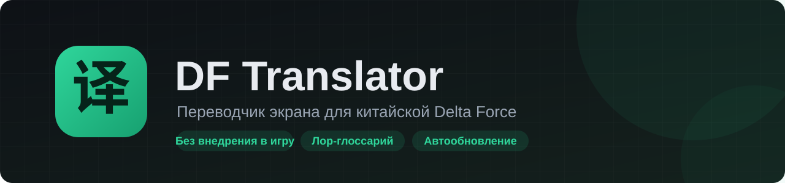

 

Сделано **LastNova** для комьюнити **Moven** — китайских игроков Delta Force

## Как начать

1. Нажмите **«Скачать»** и запустите файл — значок **译** появится в трее.
2. В игре включите **«Окно без рамки»**.
3. Нажмите горячую клавишу:

| Клавиши | Что делает |
|---|---|
| `Ctrl` `Alt` `T` | перевести весь экран |
| `Ctrl` `Alt` `R` | выделить область и перевести |
| `Ctrl` `Alt` `G` | **гид по квесту**: карточка с целями и скриншотами мест |
| `Ctrl` `Alt` `X` | перевести строку под курсором |
| `Ctrl` `Alt` `C` | убрать перевод |

Программа и словарь обновляются сами.

> SmartScreen может предупредить: **«Подробнее» → «Выполнить в любом случае»**.

## Что умеет

- Все 333 квеста отделов — **по лору игры**: цели, награды, карты, что взять с собой
- **Скриншоты «Где выполнять»** прямо в карточке квеста
- Раздел «Квесты» с поиском, «История» переводов с кнопкой «Исправить»
- Три режима: **безопасный снимок** (по умолчанию), отдельная панель, плашки поверх игры

## Античит

Не внедряется в игру и не читает её память. В безопасном режиме (по умолчанию) ничего не рисуется поверх игры и не отслеживается клавиатура — только снимок экрана в обычном окне. Гарантий от ACE нет; переводите в меню и лобби, а не в рейде.

## Вопросы и проблемы

Discord-чат комьюнити или Telegram [@lastnovafuck](https://t.me/lastnovafuck)

Данные квестов — [kkrb.net](https://www.kkrb.net) (Key725). Неофициальный проект.
